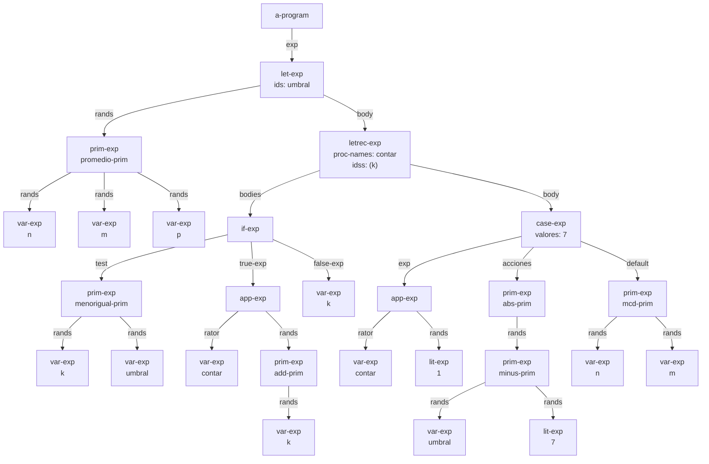
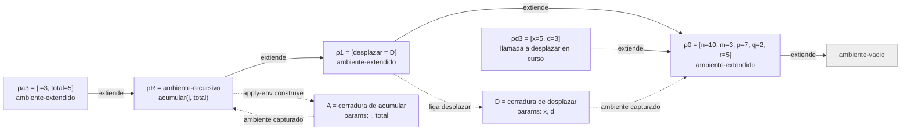

# Informe de AST y traza — Taller 2: El intérprete de Cauca

**Curso:** Fundamentos de Interpretación y Compilación de Lenguajes
de Programación — Universidad del Valle, Sede Tuluá.

**Integrantes del grupo:**

| Nombre | Código | Correo institucional |
|--------|--------|----------------------|
| Maria Fernanda Betancourt Montoya | 2459510 | maria.fernanda.betancourt@correounivalle.edu.co |
| Oliver De Jesus Arboleda Baez | 2459684 | oliver.arboleda@correounivalle.edu.co |
| Kevin Andres Rosero Romo | 2459554 | rosero.kevin@correounivalle.edu.co |

---

## 1. Gramática considerada

Gramática completa de Cauca (Partes 1 a 4), tal como está en
`src/sintaxis.rkt`. Cada producción indica, debajo, el constructor del
datatype que genera SLLGEN y sus campos.

```bnf
<programa>  ::= <expresion>
                a-program(exp)

<expresion> ::= <numero>
                lit-exp(dato)
            ::= <identificador>
                var-exp(id)
            ::= "true"
                true-exp()
            ::= "false"
                false-exp()
            ::= <primitiva> "(" {<expresion>}*(,) ")"
                prim-exp(prim, rands)
            ::= "if" <expresion> "then" <expresion> "else" <expresion> "end"
                if-exp(test, true-exp, false-exp)
            ::= "let" {<identificador> "=" <expresion>}* "in" <expresion> "end"
                let-exp(ids, rands, body)
            ::= "proc" "(" {<identificador>}*(,) ")" <expresion> "end"
                proc-exp(ids, body)
            ::= "apply" <expresion> "(" {<expresion>}*(,) ")"
                app-exp(rator, rands)
            ::= "letrec" {<identificador> "(" {<identificador>}*(,) ")" "=" <expresion>}*
                "in" <expresion> "end"
                letrec-exp(proc-names, idss, bodies, body)
            ::= "case" <expresion> {"of" <numero> "=>" <expresion>}+
                "otherwise" "=>" <expresion> "end"
                case-exp(exp, valores, acciones, default)

<primitiva> ::= "+" sum-prim()         ::= "-" minus-prim()
            ::= "*" mult-prim()        ::= "/" div-prim()
            ::= "add1" add-prim()      ::= "sub1" sub-prim()
            ::= ">" mayor-prim()       ::= ">=" mayorigual-prim()
            ::= "<" menor-prim()       ::= "<=" menorigual-prim()
            ::= "==" igual-prim()      ::= "not" not-prim()
            ::= "and" and-prim()       ::= "or" or-prim()
            ::= "abs" abs-prim()       ::= "mcd" mcd-prim()
            ::= "mcm" mcm-prim()       ::= "promedio" promedio-prim()
            ::= "xor" xor-prim()       ::= "implica" implica-prim()
            ::= "entre" entre-prim()
```

---

## 2. Ejemplos de AST

### Ejemplo 1 — Parte 5.1: `let` con `letrec`, `case` y primitivas anidadas

**Expresión concreta:**

```text
let umbral = promedio(n, m, p)
in
  letrec
    contar (k) = if <=(k, umbral)
                 then apply contar (add1(k))
                 else k
                 end
  in
    case apply contar (1)
      of 7 => abs(-(umbral, 7))
      otherwise => mcd(n, m)
    end
  end
end
```

**AST:** cada nodo lleva el nombre del constructor; en la segunda línea
va el dato que guarda (el nombre, el número o la primitiva). Las aristas
se rotulan con el campo del constructor al que pertenece el hijo.



**Explicación:**

- La raíz es `a-program`, que envuelve una sola expresión: el `let-exp`.
- El `let-exp` liga un identificador (`umbral`) a un `prim-exp` de
  `promedio-prim` con tres `var-exp` (`n`, `m`, `p`). Su cuerpo es un
  `letrec-exp`.
- El `letrec-exp` declara un procedimiento, `contar`, con un parámetro
  (`k`). El cuerpo de `contar` es un `if-exp`: la condición es un
  `prim-exp` de `menorigual-prim` sobre `k` y `umbral`; la rama
  verdadera es un `app-exp` cuyo operador es `contar` y cuyo único
  operando es un `prim-exp` de `add1`; la rama falsa es un `var-exp`
  de `k`.
- El cuerpo del `letrec-exp` es un `case-exp`. Su expresión de control es
  un `app-exp` de `contar` sobre `lit-exp 1`. Tiene una sola rama
  (`valores: 7`) cuya acción es `abs` aplicada a `-(umbral, 7)`, que se
  ve como un `prim-exp` de `abs-prim` con un `prim-exp` de `minus-prim`
  como hijo. La rama `otherwise` es `mcd(n, m)`.
- El `-` de `-(umbral, 7)` es la primitiva de resta y no un número
  negativo, porque el scanner toma el token más largo y `-(` no es un
  número. Los números aparecen como `lit-exp`, y `true`/`false` no
  figuran en este programa.
- Evaluado en el ambiente inicial el programa da `1/3` (racional exacto
  de Racket): `promedio(10, 3, 7)` es `20/3`, `contar(1)` avanza hasta
  `7` y `abs(-(20/3, 7))` es `1/3`.

---

## 3. Traza de evaluación

**Expresión a evaluar** ($e_{prog}$):

```text
let desplazar = proc (x, d) +(x, d) end
in
  letrec
    acumular (i, total) = if >(i, m)
                          then total
                          else apply acumular
                                 (add1(i), apply desplazar (total, i))
                          end
  in
    apply acumular (1, q)
  end
end
```

**Ambiente inicial:**
$\rho_0 = [\,n = 10,\ m = 3,\ p = 7,\ q = 2,\ r = 5\,]$, extendiendo a
$\rho_\varnothing$ (`ambiente-vacio`).

**Notación.** $\mathsf{value\text{-}of}(e, \rho)$ es
`(evaluar-expresion e ρ)`. $[\,x = v, \dots\,]\,\rho$ es el ambiente que
extiende a $\rho$ con esas ligaduras. $\mathsf{clo}(ids, b, \rho)$ es una
`cerradura`. $\mathsf{rec}(N, I, B, \rho)$ es un `ambiente-recursivo`.
Se abrevia con $b_{ac}$ el cuerpo de `acumular`:

```text
if >(i, m) then total
else apply acumular (add1(i), apply desplazar (total, i)) end
```

**Ambientes y valores que aparecen en la traza:**

| Nombre | Definición | Origen |
|---|---|---|
| $D$ | $\mathsf{clo}((x,d),\ \texttt{+(x, d)},\ \rho_0)$ | `proc-exp` evaluado en $\rho_0$ |
| $\rho_1$ | $[\,desplazar = D\,]\,\rho_0$ | ligadura del `let` |
| $\rho_R$ | $\mathsf{rec}([acumular],\ [(i,total)],\ [b_{ac}],\ \rho_1)$ | `letrec-exp` |
| $A$ | $\mathsf{clo}((i,total),\ b_{ac},\ \rho_R)$ | la arma `apply-env` cada vez que busca `acumular` en $\rho_R$ |
| $\rho_{a1}$ | $[\,i = 1,\ total = 2\,]\,\rho_R$ | llamada inicial |
| $\rho_{a2}$ | $[\,i = 2,\ total = 3\,]\,\rho_R$ | 1.ª llamada recursiva |
| $\rho_{a3}$ | $[\,i = 3,\ total = 5\,]\,\rho_R$ | 2.ª llamada recursiva |
| $\rho_{a4}$ | $[\,i = 4,\ total = 8\,]\,\rho_R$ | 3.ª llamada recursiva |
| $\rho_{d1}, \rho_{d2}, \rho_{d3}$ | $[\,x=2, d=1\,]\rho_0$, $[\,x=3, d=2\,]\rho_0$, $[\,x=5, d=3\,]\rho_0$ | llamadas a `desplazar` (ambiente de $D$ extendido) |

### Pasos de la traza

**Paso 1.** Punto de entrada: `evaluar-programa` evalúa la expresión del
programa en el ambiente inicial.

$$
\mathsf{value\text{-}of}(\texttt{a-program}(e_{prog}),\ \rho_\varnothing)
\ \to\ \mathsf{value\text{-}of}(e_{prog},\ \rho_0)
$$

**Paso 2.** `let-exp` de `desplazar`, en $\rho_0$. Se evalúan los
operandos en el ambiente actual y luego el cuerpo en el extendido.

- $\mathsf{value\text{-}of}(\texttt{proc (x, d) +(x, d) end},\ \rho_0)
  \Rightarrow D = \mathsf{clo}((x,d), \texttt{+(x, d)}, \rho_0)$.
  El cuerpo no se evalúa: se guarda con $\rho_0$.
- Se evalúa el cuerpo en $\rho_1 = [\,desplazar = D\,]\,\rho_0$.

**Paso 3.** `letrec-exp` en $\rho_1$: se construye
$\rho_R$ y se evalúa el cuerpo del `letrec` en él.

$$
\mathsf{value\text{-}of}(\texttt{apply acumular (1, q)},\ \rho_R)
$$

**Paso 4.** `app-exp` inicial, en $\rho_R$.

- Operador: $\mathsf{value\text{-}of}(\texttt{acumular}, \rho_R)
  = \mathsf{apply\text{-}env}(\rho_R, acumular) \Rightarrow A$
  ($acumular \in N$: se arma la clausura con $\rho_R$). Es un `procval`.
- Operandos, de izquierda a derecha:
  - $\mathsf{value\text{-}of}(\texttt{1}, \rho_R) \Rightarrow 1$.
  - $\mathsf{value\text{-}of}(\texttt{q}, \rho_R)$: $q \notin N$, se pasa a
    $\rho_1$ (no liga `q`) y a $\rho_0$: $\Rightarrow 2$.
- `apply-procedure`: 2 parámetros, 2 argumentos. El cuerpo se evalúa en
  $\rho_{a1} = [\,i = 1,\ total = 2\,]\,\rho_R$.

**Paso 5. Llamada inicial, $\rho_{a1}$.**
$\mathsf{value\text{-}of}(b_{ac},\ \rho_{a1})$ con $i = 1$, $total = 2$:

- Condición: $\mathsf{value\text{-}of}(\texttt{>(i, m)}, \rho_{a1})$:
  $i \Rightarrow 1$; $m$ no está en $[i,total]$, ni en $N$, ni en
  $\rho_1$, y en $\rho_0$ vale $3$. Resultado $1 > 3 \Rightarrow$
  `#f`. `test-value` es booleano: se toma la rama `else`.
- $\mathsf{value\text{-}of}(\texttt{apply acumular (add1(i), apply desplazar (total, i))},\ \rho_{a1})$:
  - Operador: $\mathsf{apply\text{-}env}(\rho_{a1}, acumular)$ pasa a
    $\rho_R$ $\Rightarrow A$.
  - Operando 1: $\mathsf{value\text{-}of}(\texttt{add1(i)}, \rho_{a1}) \Rightarrow 2$.
  - Operando 2: $\mathsf{value\text{-}of}(\texttt{apply desplazar (total, i)}, \rho_{a1})$:
    - Operador: `desplazar` no está en $[i,total]$ ni en $N$; en
      $\rho_1$ vale $D$.
    - Operandos: $total \Rightarrow 2$, $i \Rightarrow 1$.
    - Cuerpo de $D$ en $\rho_{d1} = [\,x = 2,\ d = 1\,]\,\rho_0$:
      $\mathsf{value\text{-}of}(\texttt{+(x, d)}, \rho_{d1}) \Rightarrow 3$.
  - `apply-procedure` $A$ con $(2, 3)$: cuerpo en $\rho_{a2}$.

**Paso 6. 1.ª llamada recursiva, $\rho_{a2} = [\,i=2,\ total=3\,]\,\rho_R$.**

- Condición: $\mathsf{value\text{-}of}(\texttt{>(i, m)}, \rho_{a2})$:
  $2 > 3 \Rightarrow$ `#f`, rama `else`.
- Operador $acumular \Rightarrow A$ (por $\rho_R$);
  $\mathsf{value\text{-}of}(\texttt{add1(i)}, \rho_{a2}) \Rightarrow 3$.
- $\mathsf{value\text{-}of}(\texttt{apply desplazar (total, i)}, \rho_{a2})$:
  operador $D$, argumentos $(3, 2)$, cuerpo
  $\mathsf{value\text{-}of}(\texttt{+(x, d)}, \rho_{d2}) \Rightarrow 3 + 2 = 5$.
- `apply-procedure` $A$ con $(3, 5)$: cuerpo en $\rho_{a3}$.

**Paso 7. 2.ª llamada recursiva, $\rho_{a3} = [\,i=3,\ total=5\,]\,\rho_R$.**

- Condición: $3 > 3 \Rightarrow$ `#f`, rama `else`.
- Operador $acumular \Rightarrow A$;
  $\mathsf{value\text{-}of}(\texttt{add1(i)}, \rho_{a3}) \Rightarrow 4$.
- $\mathsf{value\text{-}of}(\texttt{apply desplazar (total, i)}, \rho_{a3})$:
  operador $D$, argumentos $(5, 3)$, cuerpo
  $\mathsf{value\text{-}of}(\texttt{+(x, d)}, \rho_{d3}) \Rightarrow 5 + 3 = 8$.
- `apply-procedure` $A$ con $(4, 8)$: cuerpo en $\rho_{a4}$.

**Paso 8. 3.ª llamada recursiva, $\rho_{a4} = [\,i=4,\ total=8\,]\,\rho_R$.**

- Condición: $\mathsf{value\text{-}of}(\texttt{>(i, m)}, \rho_{a4})$:
  $4 > 3 \Rightarrow$ `#t`, rama `then`.
- $\mathsf{value\text{-}of}(\texttt{total}, \rho_{a4}) \Rightarrow 8$.
  No hay más llamadas.

**Paso 9. Retorno.** La llamada recursiva está en posición de cola: el
valor de cada `app-exp` es el del `if-exp` de su cuerpo, sin cálculo
pendiente. El $8$ del paso 8 es entonces el resultado de las llamadas de
los pasos 7, 6, 5 y 4, y del programa completo.

$$
\mathsf{value\text{-}of}(e_{prog},\ \rho_0) \Rightarrow 8
$$

(Comprobación: $2 + 1 + 2 + 3 = 8$, con $total$ inicial $q = 2$ y los
valores de $i$ en $1, 2, 3$.)

### Diagrama de la cadena de ambientes

El diagrama muestra el momento de la **segunda llamada recursiva** a
`acumular`, es decir, la evaluación del cuerpo en $\rho_{a3}$ (paso 7;
$i = 3$, $total = 5$), con la llamada a `desplazar` en curso.
Las flechas continuas van del ambiente que extiende hacia el ambiente
extendido; las punteadas muestran qué ambiente guarda cada clausura. Si
se toma como "segunda llamada" la primera recursiva ($\rho_{a2}$), la
cadena es la misma y solo cambian los valores de $i$ y $total$.



La clausura $D$ guardó $\rho_0$ (el ambiente donde se escribió `proc`),
por eso el cuerpo de `desplazar` ve `n, m, p, q, r` y sus parámetros, pero
no `i` ni `total`. La clausura $A$ guarda $\rho_R$, así que el cuerpo de
`acumular` se ve a sí mismo por el `ambiente-recursivo` y ve también a
`desplazar` a través de $\rho_1$.

---

## 4. Estado del almacén en una transacción

No aplica. Cauca no tiene almacén ni bloques transaccionales, y el
enunciado de la Parte 5 no pide este ejemplo.

---

## 5. Referencias

- Friedman, D. P., & Wand, M. *Essentials of Programming Languages*,
  3.ª ed., MIT Press, 2008. Sección 2.5 (sintaxis abstracta y
  datatypes), sección 2.2 (ambientes), sección 3.3 (procedimientos y
  clausuras) y sección 3.4 (procedimientos recursivos, Figura 3.9).
- Delgado, C. A. *Taller 2: El intérprete de Cauca*, Fundamentos de
  Interpretación y Compilación de Lenguajes de Programación,
  Universidad del Valle, octubre de 2026.
