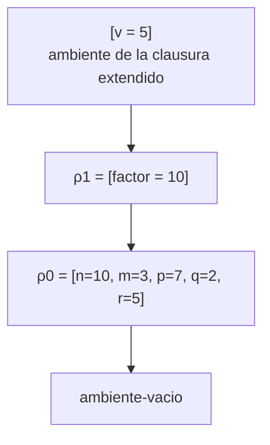
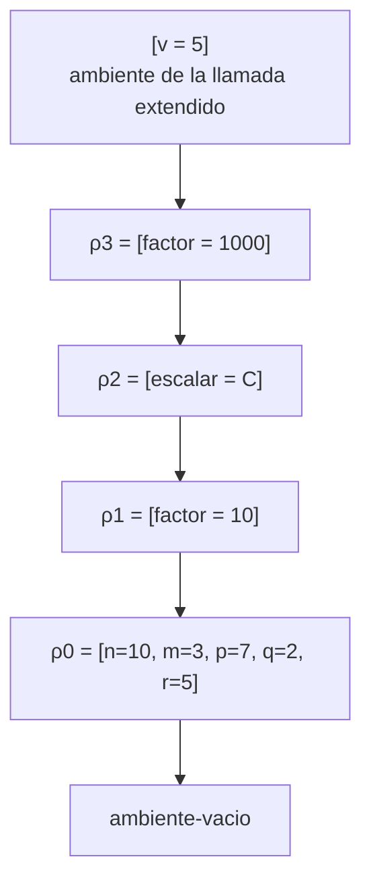
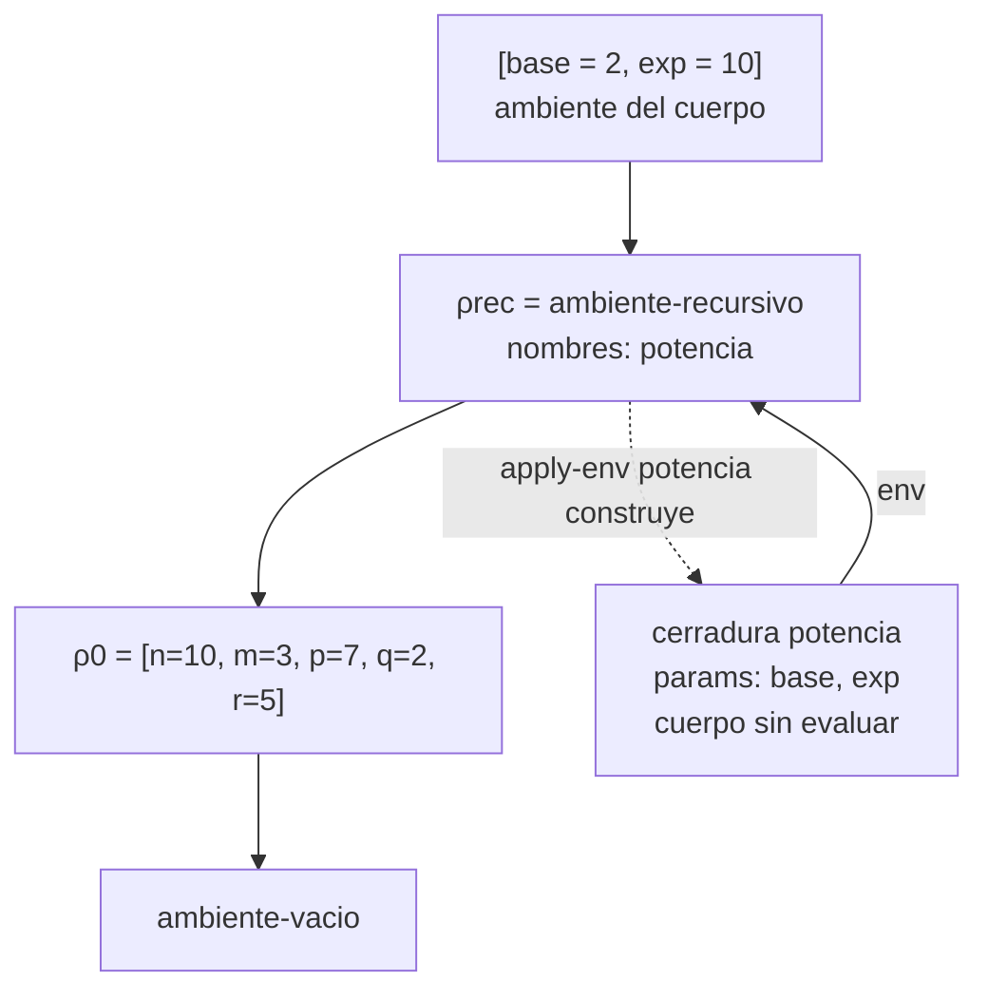
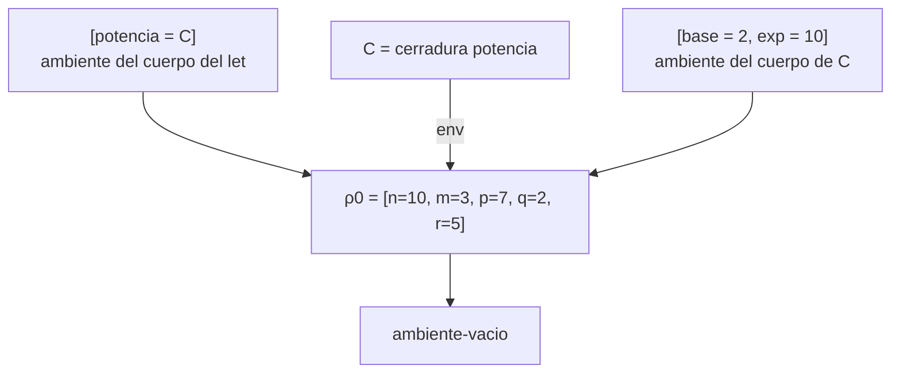

# Informe de corrección — Taller 2: El intérprete de Cauca

**Curso:** Fundamentos de Interpretación y Compilación de Lenguajes
de Programación — Universidad del Valle, Sede Tuluá.

**Integrantes del grupo:**

| Nombre | Código | Correo institucional |
|--------|--------|----------------------|
| Maria Fernanda Betancourt Montoya | 2459510 | rosero.kevin@correounivalle.edu.co |
| Oliver De Jesus Arboleda Baez | 2459684 | oliver.arboleda@correounivalle.edu.co |
| Kevin Andres Rosero Romo | 2459554 | maria.fernanda.betancourt@correounivalle.edu.co |

---

## 1. Marco formal

### 1.1 Corrección de programas recursivos

Sea $f : A \to B$ una función y $A$ un conjunto definido
recursivamente. Sea $P_f$ un programa recursivo en Racket que
pretende calcular $f$. Decimos que $P_f$ es correcto con respecto a
su especificación si se cumple:

$$
\forall a \in A \,:\, P_f(a) = f(a)
$$

La estrategia de demostración es la **inducción estructural**
sobre $A$:

- **Caso base:** para cada valor básico $a_0 \in A$ se verifica
  $P_f(a_0) = f(a_0)$.
- **Caso inductivo:** asumiendo la **hipótesis de inducción**
  $P_f(a') = f(a')$ para las subestructuras $a'$ que forman $a$, se
  demuestra $P_f(a) = f(a)$.

### 1.2 Corrección de programas iterativos

Para un programa iterativo se formalizan un estado inicial $s_0$, un
predicado $\text{es-final?}(s)$, una invariante $\text{Inv}(s)$ y una
transformación $\text{transformar}(s)$, y se demuestra que
$\text{Inv}(s_0)$ se cumple, que $\text{Inv}$ se conserva en cada paso,
que al llegar al estado final la invariante implica la post-condición y
que existe una cota estrictamente decreciente sobre $\mathbb{N}$.

En este informe no se usa este esquema: las funciones analizadas
(`apply-procedure`, la ligadura recursiva y `case-exp`) son recursivas
sobre estructuras (listas de ramas, cadenas de ambientes) o no tienen
repetición, así que se demuestran con 1.1. El invariante que pide la
Parte 6.2 es una propiedad del ambiente, no de un bucle.

### 1.3 Notación y lemas auxiliares

**Notación.**

- $\mathsf{vo}(e,\rho)$ es `value-of`, es decir, `(evaluar-expresion e ρ)`.
  Su resultado es un valor o un $\mathsf{error}$ (`eopl:error`).
- $\rho_\varnothing$ es `ambiente-vacio`.
- $[x_1 = v_1, \dots, x_k = v_k]\,\rho$ es
  `(ambiente-extendido '(x1 ... xk) (list v1 ... vk) ρ)`.
- $\rho_0 = [n=10,\ m=3,\ p=7,\ q=2,\ r=5]\,\rho_\varnothing$ es el
  ambiente inicial.
- $\mathsf{rec}(N, I, B, \rho)$ es
  `(ambiente-recursivo N I B ρ)`, con $N$ la lista de nombres, $I$ la
  lista de listas de parámetros y $B$ la lista de cuerpos.
- $\mathsf{clo}(ids, b, \rho)$ es `(cerradura ids b ρ)`.

**Lema 1 (apply-env).** Por inspección de `cases` en `apply-env`:

1. $\mathsf{apply\text{-}env}(\rho_\varnothing, x) = \mathsf{error}$
   (variable no ligada).
2. $\mathsf{apply\text{-}env}([x_1 = v_1,\dots,x_k=v_k]\rho', x)$ es
   $v_i$ si $i$ es el **primer** índice con $x_i = x$; si $x$ no
   está en la lista, es $\mathsf{apply\text{-}env}(\rho', x)$.
3. $\mathsf{apply\text{-}env}(\rho_r, x)$, con
   $\rho_r = \mathsf{rec}(N, I, B, \rho')$, es
   $\mathsf{clo}(I_i, B_i, \rho_r)$ si $i$ es el primer índice con
   $N_i = x$ (la clausura se construye en ese momento y recibe como
   ambiente el propio $\rho_r$); si $x \notin N$, es
   $\mathsf{apply\text{-}env}(\rho', x)$.

*Demostración.* Es la lectura directa de las tres ramas de `cases`,
con `buscar-posicion` devolviendo el primer índice de $x$ o `#f`. $\square$

**Corolario (shadowing).** $\mathsf{apply\text{-}env}([x = v]\,\rho', x) = v$
para cualquier $\rho'$: la ligadura más reciente tapa a las anteriores.

**Lema 2 (terminación de apply-env).** `apply-env` termina para todo
ambiente.

*Demostración.* Por inducción estructural sobre $\rho$. Si
$\rho = \rho_\varnothing$ termina con error. Si es extendido o
recursivo, o responde de inmediato, o llama a `apply-env` sobre el
ambiente padre, que es una subestructura estrictamente menor; por
hipótesis de inducción termina. $\square$

**Lema 3 (evaluar-rands).** Para $e_1,\dots,e_k$ y $\rho$,
`(evaluar-rands (list e1 ... ek) ρ)` evalúa cada $e_i$ exactamente una
vez, en orden $e_1, e_2, \dots, e_k$, todas en $\rho$, y retorna
$(\mathsf{vo}(e_1,\rho), \dots, \mathsf{vo}(e_k,\rho))$.

*Demostración.* Por inducción sobre $k$. Para $k=0$ retorna `'()`.
Para $k>0$, el `let` liga `primer-valor` a $\mathsf{vo}(e_1,\rho)$
**antes** de evaluar el cuerpo del `let`, que contiene la llamada
recursiva sobre $e_2,\dots,e_k$; por hipótesis de inducción esa llamada
evalúa $e_2,\dots,e_k$ en orden, una vez cada una, en el mismo $\rho$.
Si alguna evaluación falla, el error se propaga y las posteriores no se
evalúan. $\square$

---

## 2. Funciones analizadas

### 2.1 Corrección de `apply-procedure` (Parte 6.1)

#### Especificación

- **Tipo:** `apply-procedure : procval x lista de valores -> valor`
- **Pre-condición:**

  $$
  \text{Pre}(proc, args) \equiv proc = \mathsf{clo}(ids, b, \rho_d)
  \ \land\ ids \in \text{Symbol}^{*}\ \land\ b \in \text{Expresion}
  \ \land\ \rho_d \in \text{Ambiente}\ \land\ args \in \text{Valor}^{*}
  $$

  El campo `env` de `cerradura` no se verifica (se declara con
  `(lambda (v) #t)` para evitar el ciclo de módulos), pero los dos únicos
  sitios que construyen clausuras, `proc-exp` y `apply-env`, siempre le
  pasan un ambiente.

- **Post-condición:** sean $m = |ids|$ y $k = |args|$.

  $$
  \text{Post}(proc, args, r) \equiv
  \begin{cases}
  r = \mathsf{vo}\big(b,\ [ids = args]\,\rho_d\big) & \text{si } m = k\\[4pt]
  r = \mathsf{error} \ \text{ sin evaluar } b & \text{si } m \neq k
  \end{cases}
  $$

La corrección es **parcial** respecto al cuerpo: `apply-procedure`
termina si y solo si termina $\mathsf{vo}(b, [ids=args]\rho_d)$. La
aplicación en sí (`app-exp`) se especifica en el punto 3 de abajo.

#### Código

```racket
;; apply-procedure : procval x lista de valores -> valor
(define apply-procedure
  (lambda (proc args)
    (cases procval proc
      (cerradura (ids body env-definicion)
        (if (= (length ids) (length args))
            (evaluar-expresion body
                               (ambiente-extendido ids args env-definicion))
            (eopl:error 'apply-procedure
                        "Cantidad de argumentos incorrecta: se esperaban ~s y llegaron ~s"
                        (length ids)
                        (length args)))))))

;; fragmentos de evaluar-expresion
(proc-exp (ids body)
  (cerradura ids body env))

(app-exp (rator rands)
  (let ((proc (evaluar-expresion rator env)))
    (if (procval? proc)
        (apply-procedure proc (evaluar-rands rands env))
        (eopl:error 'evaluar-expresion
                    "El operador de apply no es un procedimiento: ~s"
                    proc))))
```

**Estrategia de demostración:** desarrollo ecuacional del código (no hay
recursión propia en `apply-procedure`) y razonamiento por casos sobre las
dos pruebas, `procval?` y la igualdad de longitudes.

#### Demostración

**(1) Especificación.** Se verifica $\text{Post}$ por casos sobre
$m = k$.

- Como `procval` tiene una única variante, `cerradura`, el `cases` es
  exhaustivo y bajo $\text{Pre}$ entra siempre en esa rama, ligando
  $ids$, $body = b$ y $env\text{-}definicion = \rho_d$.
- Si $m = k$, el `if` toma la rama verdadera y el resultado es
  `(evaluar-expresion b (ambiente-extendido ids args ρd))`, que es
  $\mathsf{vo}(b, [ids=args]\rho_d)$.
- Si $m \neq k$, toma la rama falsa, que es una llamada a `eopl:error`;
  `evaluar-expresion` no se invoca, así que $b$ no se evalúa. $\square$

**(2) El cuerpo se evalúa en el ambiente de la clausura extendido, no en
el de la llamada.**

*Argumento general.* La firma de `apply-procedure` es
`(lambda (proc args) ...)`: **no recibe el ambiente de la llamada**, de
modo que el cuerpo no puede evaluarse en él. El único ambiente
disponible es el campo `env-definicion` de la clausura, y
`apply-procedure` lo extiende con las ligaduras $ids = args$.

Ese campo es el ambiente vigente al construir la clausura: `proc-exp`
ejecuta `(cerradura ids body env)`, donde `env` es el ambiente en que se
evalúa el `proc-exp`, y `apply-env` construye clausuras de `letrec` con
el ambiente recursivo (Lema 1.3). Además `proc-exp` no evalúa el cuerpo
al construir la clausura: lo guarda sin evaluar.

*Ejemplo de contraste.* El programa de la Parte 3 es:

```
let factor = 10
in
  let escalar = proc (v) *(v, factor) end
  in
    let factor = 1000
    in
      apply escalar (5)
    end
  end
end
```

Se parte de $\rho_0$ y se construyen los ambientes:

| Ambiente | Definición | Origen |
|---|---|---|
| $\rho_1$ | $[factor = 10]\,\rho_0$ | primer `let` |
| $C$ | $\mathsf{clo}((v),\ \texttt{*(v, factor)},\ \rho_1)$ | `proc-exp` evaluado en $\rho_1$ |
| $\rho_2$ | $[escalar = C]\,\rho_1$ | segundo `let` |
| $\rho_3$ | $[factor = 1000]\,\rho_2$ | tercer `let` (**ambiente de la llamada**) |

En `apply escalar (5)`, evaluado en $\rho_3$:

1. $\mathsf{apply\text{-}env}(\rho_3, escalar)$: $\rho_3$ solo liga
   `factor`, así que se pasa a $\rho_2$, que da $C$. Es un `procval`.
2. Los operandos dan $(5)$. Hay un parámetro y un argumento.
3. `apply-procedure` evalúa el cuerpo en
   $\rho_c = [v = 5]\,\rho_1$ (ambiente de la **clausura** extendido).
4. $\mathsf{vo}(\texttt{*(v, factor)}, \rho_c) = 5 \cdot 10 = 50$, porque
   $\mathsf{apply\text{-}env}(\rho_c, factor)$ no halla `factor` en
   $[v=5]$ y lo encuentra en $\rho_1$ con valor $10$.

**Cadena de ambientes que da 50** (evaluación en el ambiente de la
definición; las flechas van del ambiente que extiende al extendido):



**Cadena de ambientes que daría 5000** (evaluación, por error, en el
ambiente de la llamada, que es lo que la clausura evita):



En la segunda cadena $\mathsf{apply\text{-}env}(\,[v=5]\rho_3,\ factor)$
encuentra primero $factor = 1000$ (shadowing, Lema 1.2) y el resultado
sería $5 \cdot 1000 = 5000$. Las dos cadenas difieren solo en el ambiente
que se extiende ($\rho_1$ frente a $\rho_3$). Como `apply-procedure`
extiende el de la clausura, la implementación produce **50**. $\square$

**(3) La aplicación levanta error exactamente cuando el operador no es
un procedimiento o la cantidad de argumentos no coincide.**

*Enunciado.* Sea $e = \texttt{app-exp}(r, [a_1,\dots,a_k])$ evaluada en
$\rho$, y sea $v = \mathsf{vo}(r,\rho)$ (se supone que evalúa sin error;
si no, el error viene del operador y no de la aplicación). Un **error de
la aplicación** es uno levantado por el código de `app-exp` o de
`apply-procedure`, no uno proveniente de evaluar el operador, los
operandos o el cuerpo. Entonces:

- (a) Si $v$ no es un `procval`, la evaluación de $e$ levanta error y
  no se evalúa ningún operando.
- (b) Si $v = \mathsf{clo}(ids, b, \rho_d)$ y los operandos evalúan sin
  error, la aplicación levanta error si y solo si $|ids| \neq k$.
- Fuera de (a) y (b) la aplicación no levanta error propio: el
  resultado es $\mathsf{vo}(b, [ids = w]\rho_d)$, que puede fallar
  solamente por errores internos del cuerpo.

*Demostración.* En el código de `app-exp` y de `apply-procedure` hay
exactamente dos llamadas a `eopl:error`:

1. En `app-exp`, rama falsa de `(procval? proc)`.
2. En `apply-procedure`, rama falsa de `(= (length ids) (length args))`.

(a) $v$ no es `procval` $\Rightarrow$ `(procval? proc)` es `#f` $\Rightarrow$
se ejecuta la llamada 1. Como `evaluar-rands` está dentro de la rama
verdadera, los operandos no se evalúan.

(b) $v$ es `procval` $\Rightarrow$ la llamada 1 no se ejecuta, y
`evaluar-rands` evalúa los operandos en orden (Lema 3), dando $w$ con
$|w| = k$. Se invoca `apply-procedure`; por el punto (1), levanta error
si y solo si $|ids| \neq k$ (llamada 2), y si no, evalúa el cuerpo.

Como no hay otras llamadas a `eopl:error` en ese código, el error propio
ocurre **solo** en esos dos casos, y en ellos **siempre**. $\square$

#### Conclusión

`apply-procedure` cumple $\text{Post}$; el cuerpo se evalúa en
$[ids=args]\rho_d$, que en el ejemplo de contraste da $50$ y no $5000$; y
la aplicación levanta error exactamente cuando el operador no es
procedimiento o cuando la cantidad de argumentos no coincide.

---

### 2.2 Corrección de la ligadura recursiva `letrec` (Parte 6.2)

#### Especificación

- **Tipo:** `letrec-exp : (proc-names, idss, bodies, body)` se evalúa en
  `evaluar-expresion` como
  `(evaluar-expresion body (ambiente-recursivo proc-names idss bodies env))`.
- **Pre-condición:** $N = proc\text{-}names$, $I = idss$,
  $B = bodies$ listas de la misma longitud $n$ (las produce el parser a
  partir del mismo `arbno`), con $N$ sin repeticiones, y $\rho$ un
  ambiente.
- **Post-condición:** $\mathsf{vo}(\texttt{letrec-exp}(N,I,B,e), \rho) =
  \mathsf{vo}(e, \rho_r)$ con $\rho_r = \mathsf{rec}(N,I,B,\rho)$, y
  $\rho_r$ cumple el invariante de abajo.

**Invariante $\text{Inv}_{rec}(\rho_r)$.** Sea
$\rho_r = \mathsf{rec}(N,I,B,\rho)$. Para todo $i \in \{1..n\}$:

1. $\mathsf{apply\text{-}env}(\rho_r, N_i) = \mathsf{clo}(I_i, B_i, \rho_r)$.
2. Para toda variable $x \notin N$,
   $\mathsf{apply\text{-}env}(\rho_r, x) = \mathsf{apply\text{-}env}(\rho, x)$.

Consecuencia que importa: el cuerpo de $N_i$ se evalúa, cuando se invoca
con argumentos $w$, en $\rho_i^{cuerpo} = [I_i = w]\,\rho_r$, y para todo
$j \in \{1..n\}$ tal que $N_j \notin I_i$ (si un parámetro se llama igual
que un procedimiento, lo tapa por shadowing):

$$
\mathsf{apply\text{-}env}\big([I_i = w]\,\rho_r,\ N_j\big)
= \mathsf{clo}(I_j, B_j, \rho_r).
$$

Es decir, el ambiente del cuerpo de cada procedimiento contiene **a
todos** los procedimientos del mismo `letrec`, incluido él mismo.

#### Código

```racket
(letrec-exp (proc-names idss bodies body)
  (let ((env-recursivo
         (ambiente-recursivo proc-names idss bodies env)))
    (evaluar-expresion body env-recursivo)))

;; ambiente-recursivo no guarda clausuras: guarda nombres, parámetros
;; y cuerpos. apply-env arma la clausura al encontrar el nombre:
(ambiente-recursivo (proc-names idss bodies amb-padre)
  (let ((pos (buscar-posicion id proc-names)))
    (if pos
        (cerradura (list-ref idss pos) (list-ref bodies pos) env)
        (apply-env amb-padre id))))
```

En esa rama `env` es el parámetro de `apply-env`, es decir, **el propio
ambiente recursivo** (no `amb-padre`).

**Estrategia de demostración:** desarrollo ecuacional con el Lema 1 y el
corolario de shadowing; terminación con una medida natural decreciente.

#### Demostración

**(1) Enunciado del invariante.** Está dado arriba como
$\text{Inv}_{rec}$.

**(2) `apply-env` sobre un `ambiente-recursivo` construye una clausura
que lo satisface.**

*Parte 1 del invariante.* Por el Lema 1.3, con $N$ sin repeticiones el
primer índice de $N_i$ en $N$ es $i$, y
$\mathsf{apply\text{-}env}(\rho_r, N_i) = \mathsf{clo}(I_i, B_i, \rho_r)$,
porque la clausura recibe como ambiente el parámetro `env` completo, que
es $\rho_r$.

*Parte 2.* Si $x \notin N$, `buscar-posicion` devuelve `#f` y la rama
llama a `(apply-env amb-padre id)`, es decir,
$\mathsf{apply\text{-}env}(\rho, x)$. Así las variables libres del
`letrec` conservan su significado (alcance estático).

*Consecuencia para el cuerpo.* Si se aplica $\mathsf{clo}(I_i,B_i,\rho_r)$
a $w$ con $|w| = |I_i|$, por 2.1 el cuerpo se evalúa en
$[I_i = w]\rho_r$. Para $N_j \notin I_i$, por el Lema 1.2 la búsqueda
pasa al ambiente padre $\rho_r$ y por la parte 1 devuelve
$\mathsf{clo}(I_j, B_j, \rho_r)$. Esto vale también para $j \neq i$, que
es lo que permite la **recursión mutua**. $\square$

*Por qué no hay circularidad en los datos.* $\rho_r$ no contiene
clausuras: contiene $N, I, B$ y $\rho$. La clausura se arma cada vez que
se busca el nombre, apuntando a $\rho_r$. El ambiente "que todavía no
existe" cuando se escribe el procedimiento queda disponible porque la
clausura se construye **después** de que $\rho_r$ existe, en el momento
de la búsqueda (EOPL, sección 3.4, Figura 3.9).

El ambiente que ve el cuerpo en el ejemplo `potencia` queda así
(la flecha punteada es la construcción de la clausura en `apply-env`):



**(3) Por qué la misma declaración con `let` no satisface el invariante,
y qué error produce.**

Versión con `let`:

```
let potencia = proc (base, exp)
                 if ==(exp, 0)
                 then 1
                 else *(base, apply potencia (base, sub1(exp)))
                 end
               end
in
  apply potencia (2, 10)
end
```

En `let-exp` los operandos se evalúan en el ambiente **actual** $\rho_0$,
no en el extendido. Por tanto el `proc-exp` produce
$C = \mathsf{clo}((base, exp),\ b,\ \rho_0)$, y el cuerpo del `let` se
evalúa en $[potencia = C]\rho_0$. La clausura queda con el ambiente
$\rho_0$, que **no** liga `potencia`:



Al invocar `apply potencia (2, 10)` el cuerpo se evalúa en
$[base=2, exp=10]\rho_0$. Como $exp = 10 \neq 0$, la condición
$\texttt{==(exp, 0)}$ es `#f` y se evalúa la rama `else`. Los operandos
de `*` se evalúan de izquierda a derecha: $base = 2$ y luego
`apply potencia (...)`, cuyo operador es `potencia`.
$\mathsf{apply\text{-}env}([base=2, exp=10]\rho_0,\ potencia)$ recorre
$[base, exp]$, luego $\rho_0$ (`n, m, p, q, r`) y llega a
$\rho_\varnothing$: **se levanta el error `Variable no ligada: potencia`.**

Esto viola el invariante: la parte 1 exige
$\mathsf{apply\text{-}env}(\rho_i^{cuerpo}, potencia) =
\mathsf{clo}(\dots)$, y aquí la búsqueda falla. La causa es que el
ambiente de la clausura se fijó **antes** de que el nombre quedara
ligado. Si hubiera un `potencia` previo en $\rho_0$ el programa no
fallaría, sino que llamaría **a ese otro procedimiento**, un error
silencioso peor que el aviso. $\square$

**(4) Terminación del ejemplo de `potencia`.**

```
letrec
  potencia (base, exp) = if ==(exp, 0)
                         then 1
                         else *(base, apply potencia (base, sub1(exp)))
                         end
in
  apply potencia (2, 10)
end
```

*Medida decreciente:* $\mu = $ el valor del parámetro `exp`.

- En la llamada inicial $\mu = 10 \in \mathbb{N}$.
- Si $\mu = 0$, la condición $\texttt{==(exp, 0)}$ es verdadera y se
  retorna $1$ **sin** llamada recursiva (caso base).
- Si $\mu > 0$, la llamada recursiva se hace con `sub1(exp)`, de valor
  $\mu - 1$. Como $\mu \geq 1$, $\mu - 1 \in \mathbb{N}$ y
  $\mu - 1 < \mu$.

Una medida en $\mathbb{N}$ que decrece estrictamente en cada llamada no
puede decrecer indefinidamente, así que hay a lo sumo $10$ llamadas
recursivas (en total $11$ invocaciones, con $\mu = 10, 9, \dots, 0$). El
cómputo termina.

*Corrección del valor,* por inducción sobre $\mu = n \in \mathbb{N}$, con
$\text{potencia}(b, n) = b^n$:

- **Caso base** $n = 0$: devuelve $1 = b^0$.
- **Caso inductivo** $n > 0$: por el invariante, la llamada recursiva
  encuentra `potencia` (parte 1). Por hipótesis de inducción
  $\text{potencia}(b, n-1) = b^{n-1}$, y el resultado es
  $b \cdot b^{n-1} = b^n$.

Con $b = 2$ y $n = 10$ se obtiene $2^{10} = 1024$.

*Observación.* La precondición $exp \in \mathbb{N}$ es necesaria: con un
valor negativo o no entero (por ejemplo `2.5`) `exp` nunca vale $0$ y la
recursión no termina.

#### Conclusión

El ambiente recursivo cumple $\text{Inv}_{rec}$, de modo que cada
procedimiento del `letrec` se ve a sí mismo y a los demás; con `let`
falla porque la clausura se fija en un ambiente sin el nombre, lo que
produce `Variable no ligada`; y `potencia` termina con $\mu = exp$.

---

### 2.3 Corrección de `case-exp` (Parte 6.3)

#### Especificación

Sea `case-exp(control, valores, acciones, default)` con
$V = (v_1,\dots,v_n)$ los literales y $A = (a_1,\dots,a_n)$ las acciones,
$d$ la rama `otherwise`, y $c = \mathsf{vo}(control, \rho)$.

- **Pre-condición:** $|V| = |A| = n \geq 0$ (el parser genera las dos
  listas desde la misma repetición `arbno`; la gramática de SLLGEN admite
  $n = 0$, cuyo comportamiento queda cubierto por el caso base) y
  $\rho$ es un ambiente.
- **Post-condición.** Se define la selección sobre las listas:

  $$
  \text{sel}(c, [\,], [\,], d) = d
  \qquad
  \text{sel}(c, v{::}V', a{::}A', d) =
  \begin{cases} a & \text{si } c = v\\ \text{sel}(c, V', A', d) & \text{si } c \neq v \end{cases}
  $$

  y entonces:

  $$
  \text{Post}(r) \equiv
  \begin{cases}
  r = \mathsf{error} & \text{si } c \text{ no es un número}\\
  r = \mathsf{vo}\big(\text{sel}(c, V, A, d),\ \rho\big) & \text{si } c \text{ es un número}
  \end{cases}
  $$

  Es decir, si $c$ es número, se evalúa la acción de la **primera**
  rama con $c = v_i$, o $d$ si no hay ninguna. La comparación es la
  igualdad numérica `=`.

#### Código

```racket
(case-exp (control valores acciones default)
  (let ((valor-control (evaluar-expresion control env)))
    (if (number? valor-control)
        (letrec ((evaluar-rama
                  (lambda (resto-valores resto-acciones)
                    (if (null? resto-valores)
                        (evaluar-expresion default env)
                        (if (= valor-control (car resto-valores))
                            (evaluar-expresion (car resto-acciones) env)
                            (evaluar-rama (cdr resto-valores)
                                           (cdr resto-acciones)))))))
          (evaluar-rama valores acciones))
        (eopl:error 'evaluar-expresion
                    "La expresion de control de case debe ser numerica: ~s"
                    valor-control))))
```

**Estrategia de demostración:** inducción estructural sobre la lista de
ramas para `evaluar-rama`; y razonamiento sobre la estructura sintáctica
del código para la evaluación única del control.

#### Demostración

**(1) Especificación.** Es el enunciado de $\text{Post}$ de arriba.

**(2) Inducción estructural sobre la lista de ramas.** Sea $c$ un número
fijo. Se prueba, por inducción sobre la longitud $n$ de $V$ (con
$|A| = n$):

$$
P(n):\quad \text{evaluar-rama}(V, A) = \mathsf{vo}\big(\text{sel}(c, V, A, d), \rho\big)
$$

- **Caso base** $n = 0$: `(null? resto-valores)` es verdadero, y el
  resultado es $\mathsf{vo}(d, \rho)$. Como
  $\text{sel}(c,[\,],[\,],d) = d$, vale $P(0)$. Este es el caso en que
  **no hay ninguna coincidencia** y se evalúa `otherwise`.

- **Caso inductivo** $n > 0$, con $V = v{::}V'$, $A = a{::}A'$ y $P$
  válido para listas de longitud $n-1$:
  - Si $c = v$: el `if` interno toma la rama verdadera y devuelve
    $\mathsf{vo}(a, \rho)$, que es $\mathsf{vo}(\text{sel}(c, V, A, d), \rho)$.
    La llamada recursiva no se ejecuta: las ramas posteriores no se
    examinan ni se evalúan, de modo que se elige la **primera**
    coincidencia.
  - Si $c \neq v$: la llamada recursiva es
    $\text{evaluar-rama}(V', A')$; por hipótesis de inducción es
    $\mathsf{vo}(\text{sel}(c, V', A', d), \rho)$, que por definición
    es $\mathsf{vo}(\text{sel}(c, V, A, d), \rho)$.

  Así vale $P(n)$ para todo $n$. $\square$

*Error por control no numérico.* Si $c$ no es un número (un booleano o un
procedimiento, por ejemplo), `(number? valor-control)` es `#f` y se
ejecuta `eopl:error`. En esa rama no se llama a `evaluar-rama`, por lo
que ninguna acción ni `otherwise` se evalúa. Además, si $c$ es número,
el código de `case-exp` no tiene llamadas a `eopl:error`: los únicos
errores posibles son los internos de la acción elegida. Por lo tanto el
error por control ocurre **si y solo si** $c$ no es número. $\square$

**(3) La expresión de control se evalúa una sola vez.** En el código el
subárbol `control` aparece en **un único** punto:
`(evaluar-expresion control env)`, como inicialización del `let`, fuera
de `evaluar-rama`. El `let` evalúa su inicialización una vez y liga el
resultado a `valor-control`. `evaluar-rama` solo hace referencias a esa
variable (`(= valor-control (car resto-valores))`) y nunca recibe la
expresión `control`, ni su ambiente por separado para reevaluarla. Sea
$E(n)$ el número de evaluaciones de `control` con $n$ ramas: la llamada
ocurre en un sitio que se ejecuta una vez por evaluación del `case-exp`
y no depende de las llamadas a `evaluar-rama`, por lo tanto
$E(n) = 1$ para todo $n$. $\square$

Como Cauca no tiene efectos laterales, la diferencia no se vería en el
valor sino en el costo: si el código volviera a evaluar `control` en cada
rama costaría $n$ evaluaciones en el peor caso (por ejemplo, con un
control que sea una llamada recursiva).

**(4) Terminación del recorrido sobre las ramas.** La medida es
$\mu = $ la longitud de `resto-valores`. En cada llamada recursiva
`resto-valores` pasa a `(cdr resto-valores)`, de longitud $\mu - 1$, y la
recursión se detiene cuando `(null? resto-valores)`, es decir, con
$\mu = 0$. Como $\mu \in \mathbb{N}$ decrece estrictamente en cada
llamada y las listas son finitas (el AST es finito), hay a lo sumo
$n + 1$ llamadas a `evaluar-rama`. La precondición $|V| = |A|$ garantiza
que `(car resto-acciones)` es seguro cuando `resto-valores` no es vacía,
porque `resto-acciones` se recorre al mismo paso. El recorrido termina;
la evaluación de la acción elegida es independiente de esto. $\square$

#### Conclusión

`case-exp` cumple su especificación: evalúa el control una sola vez,
elige la acción de la primera coincidencia, cae en `otherwise` cuando no
hay ninguna, levanta error exactamente cuando el control no es un número,
y su recorrido de ramas termina en a lo sumo $n+1$ llamadas.

---

## 3. Propiedades adicionales

### 3.1 Shadowing de ambientes (`apply-env`)

**Propiedad.** La ligadura más reciente tiene prioridad sobre las
anteriores: si $x$ está ligado en varios niveles de la cadena, el valor
que devuelve `apply-env` es el del nivel más cercano al ambiente
consultado; y dentro de un mismo nivel, el de la primera aparición en
`ids`.

**Demostración.** Es el Lema 1 y su corolario, probados en 1.3, con el
Lema 2 (terminación) por inducción estructural sobre el ambiente. Se usa
en 2.1 (la parte 3 del ejemplo: `factor = 10` frente a `factor = 1000`
según el ambiente que se extienda) y en 2.2 (un parámetro del
procedimiento tapa a un procedimiento del `letrec` del mismo nombre).

---

## 4. Referencias

- Friedman, D. P., & Wand, M. *Essentials of Programming Languages*,
  3.ª ed., MIT Press, 2008. Sección 3.2 (el lenguaje LET), sección 3.3
  (procedimientos y clausuras, Figura 3.7) y sección 3.4 (procedimientos
  recursivos, Figura 3.9).
- Delgado, C. A. *Taller 2: El intérprete de Cauca*, Fundamentos de
  Interpretación y Compilación de Lenguajes de Programación,
  Universidad del Valle, octubre de 2026.
